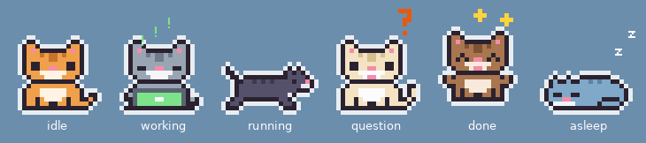
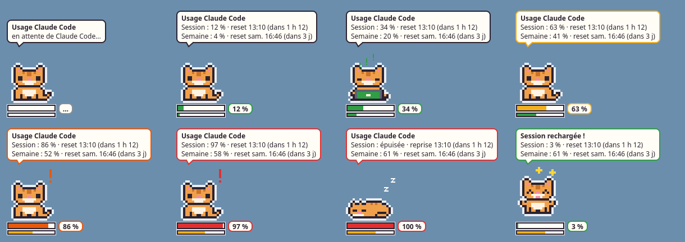
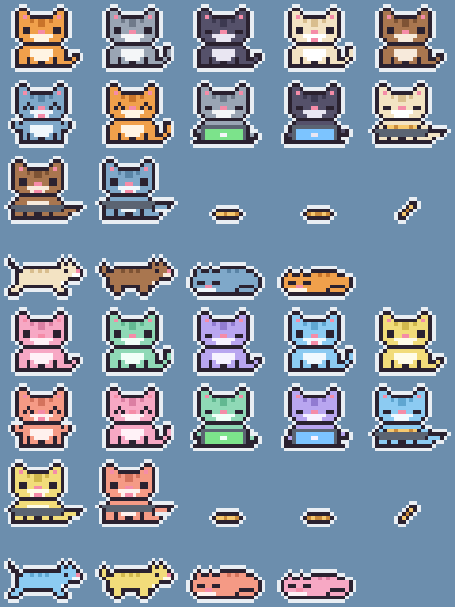

# we-always-need-cats

Un petit chat en pixel art sur le bureau, au-dessus de toutes les fenêtres, qui
montre ce que fait chaque session Claude Code.



*English: [README.md](README.md)*

- Un chat par session Claude Code ouverte, chacun avec son pelage.
- Un chaton par sous-agent en cours d'exécution, d'une couleur propre à chaque
  type d'agent.
- Une bulle indique le projet et l'action en cours.
- Un chat à part surveille les limites d'usage de Claude Code (voir
  [Le chat d'usage](#le-chat-dusage)).

## Ce que fait le chat

| Situation dans Claude Code | Comportement du chat |
|---|---|
| Session ouverte, rien en cours | Assis à sa place, puis endormi après 3 minutes |
| Claude travaille | Tape sur son ordinateur ; la bulle décrit l'action |
| Sous-agents en cours | Des chatons travaillent à côté de lui |
| Question ou demande d'autorisation | Court vers la souris et la suit, bulle orange |
| Tâche terminée | Court vers la souris, saute de joie, bulle verte ; retourne à sa place après 30 secondes |
| Session fermée | Le chat disparaît |

La couleur de l'écran de son ordinateur dépend de l'activité : vert quand il
écrit un fichier, bleu quand il lit ou cherche, jaune pour une commande, violet
pour le web, rose quand il délègue à un agent, gris clair quand il réfléchit.

## Souris

- Clic gauche sur le chat : il arrête de suivre la souris et retourne à sa place.
- Glisser le chat : le poser ailleurs, ce qui devient sa nouvelle place.
- Survol : affiche le nom du projet d'un chat au repos.
- Clic droit : remettre le chat à sa place, renvoyer ce chat, ou fermer le
  programme.

Les clics traversent tout ce qui est transparent autour du chat.

## Le chat d'usage

Un chat de plus, en bas à gauche de l'écran, suit les limites d'usage du
compte : les mêmes chiffres que l'onglet Usage de `/config`.



- Jauge épaisse : la session en cours (fenêtre de 5 heures), avec son
  pourcentage.
- Jauge fine : la semaine (7 jours).
- La bulle donne les deux pourcentages et l'heure du prochain reset. Elle
  s'ouvre au survol, au clic, ou toute seule quand un seuil est franchi.

| Usage (session ou semaine) | Comportement du chat |
|---|---|
| Moins de 50 % | Assis, jauge verte ; tape sur son ordinateur quand Claude consomme |
| 50 % et plus | Pareil, jauge jaune |
| 80 % et plus | Miaule, point d'exclamation orange |
| 95 % et plus | Miaule plus vite, en rouge |
| 100 % | S'endort jusqu'au reset ; la bulle donne l'heure de reprise |
| Reset d'une limite presque atteinte | Saute de joie pendant 30 secondes |

Le chat suit l'horloge : une fois l'heure de reset passée, la jauge revient à
zéro même si Claude Code n'a rien envoyé depuis.

Souris : survol ou clic gauche pour la bulle, glisser pour le déplacer (sa
place est retenue), clic droit pour le remettre à sa place ou fermer le
programme.

Les chiffres arrivent par la status line de Claude Code, qui affiche aussi un
résumé :

```
🐱 Session 42 % ↻ 14:00 · Semaine 12 %
```

Les limites d'usage n'existent qu'avec un abonnement Claude (Pro, Max, Team),
pas avec une clé d'API. Aucun appel réseau, aucun accès aux identifiants : tout
vient de ce que Claude Code transmet à la status line.

## Pré-requis

- Linux (Wayland ou X11) **ou Windows 10/11**
- Python 3.9 ou plus récent
- PyQt6 (le module D-Bus n'est utile que sous Linux)

```bash
# Arch / Manjaro
sudo pacman -S python-pyqt6
# Debian / Ubuntu
sudo apt install python3-pyqt6 python3-pyqt6.qtdbus
# ou, dans un environnement virtuel
pip install PyQt6
```

Sous Wayland, le programme s'affiche via XWayland, seul moyen de placer une
fenêtre librement et de la garder au-dessus des autres. Le suivi de la souris
demande KWin (KDE Plasma) ; ailleurs, le chat reste à sa place et rend compte
malgré tout de ce que fait Claude Code.

### Windows

Les chats fonctionnent aussi sous Windows : `pip install PyQt6`, puis lancez les
commandes ci-dessous avec `python` au lieu de `python3` (sous Windows, `python3`
ouvre le Microsoft Store, cause habituelle de l'erreur « Python introuvable »
dans les hooks). Le script d'installation enregistre les hooks avec
l'interpréteur courant (`pythonw.exe`, donc aucune fenêtre console ne clignote).
Le suivi de la souris marche directement, sans KWin ni D-Bus ; les événements
passent par une socket UDP locale sur `127.0.0.1`.

## Installation

```bash
git clone https://github.com/MmeOokamy/we-always-need-cats.git
cd we-always-need-cats
python3 install.py
```

Le script déclare les hooks dans `~/.claude/settings.json` en conservant ce qui
s'y trouve déjà, après avoir copié le fichier dans
`~/.claude/settings.json.backup-we-always-need-cats`. Les chats arrivent au
prochain événement de Claude Code.

Il déclare aussi la status line du chat d'usage. Si une status line est déjà en
place, elle est conservée et le chat d'usage n'est pas installé ; `--force` la
remplace. `--no-usage` installe uniquement les chats de session.

Pour ne les installer que sur un projet :

```bash
python3 install.py --settings /chemin/du/projet/.claude/settings.json
```

## Réglages

Créer un fichier `config.json` à côté de `cats.py`, avec uniquement les valeurs
à changer, puis fermer le programme (clic droit sur un chat) : il redémarre au
prochain événement.

```json
{
  "scale": 4,
  "follow_mouse": true,
  "follow_after_done": 30,
  "sleep_delay": 180,
  "speed": 800,
  "log": false,
  "lang": "fr",
  "coat": "ginger",
  "warn": 50,
  "alert": 80,
  "critical": 95,
  "notify_seconds": 12,
  "keep_alive": false,
  "statusline": true
}
```

- `scale` : taille du chat (3 pour plus petit, 5 ou 6 pour plus grand).
- `follow_mouse` : mettre `false` pour que le chat reste toujours à sa place.
- `follow_after_done` : secondes de suivi de la souris après une tâche terminée.
- `sleep_delay` : secondes de repos avant qu'il s'endorme.
- `speed` : vitesse de course, en pixels par seconde.
- `log` : écrit les événements reçus dans
  `~/.cache/we-always-need-cats/cats.log`.

Pour le chat d'usage (qui suit aussi `scale`) :

- `lang` : langue de la bulle et de la status line, `fr` ou `en`.
- `coat` : pelage, `ginger`, `grey`, `black`, `cream`, `brown` ou `blue`.
- `warn`, `alert`, `critical` : seuils en pourcentage.
- `notify_seconds` : durée d'ouverture de la bulle au passage d'un seuil.
- `keep_alive` : `true` pour que le chat reste après la fermeture de Claude
  Code (utile pour attendre un reset). Sinon il part avec la dernière session.
- `statusline` : `false` pour ne rien écrire dans la status line.

## Fonctionnement

- `hook.py` est appelé par Claude Code à chaque événement (hooks déclarés dans
  `~/.claude/settings.json`). Il envoie l'essentiel de l'événement au programme
  par une socket locale, et lance le programme s'il ne tourne pas.
- `cats.py` est le programme qui affiche les chats (Python et PyQt6). Il
  s'arrête de lui-même quinze secondes après le départ du dernier chat.
- `kwin_cursor.js` est un script KWin chargé par `cats.py`. Sous Wayland, une
  application ne peut pas lire la position de la souris : KWin la transmet.
- `sprites.py` contient les dessins et les couleurs.
- `usage_statusline.py` est appelé par Claude Code à chaque rafraîchissement
  de la status line. Il reçoit les limites du compte (`rate_limits`), les
  enregistre dans `~/.cache/usage-cat/state.json`, lance `usage_cat.py` s'il ne
  tourne pas, et écrit le résumé.
- `usage_cat.py` affiche le chat d'usage et relit ce fichier chaque seconde ;
  `usage_common.py` regroupe ses réglages, ses seuils et ses textes.
- `install.py` déclare et retire les hooks et la status line.

## Modifier les dessins

Les dessins sont des grilles de caractères dans `sprites.py` (un caractère par
pixel). Après une retouche :

```bash
python3 sprites.py preview.png
```

produit une planche de toutes les images pour contrôler le résultat.



## Essayer sans Claude Code

```bash
python3 demo.py            # scénario complet, environ 40 secondes
python3 demo.py question   # un seul état : idle, work, agents, question, done, end

python3 usage_demo.py      # chat d'usage : scénario complet, environ 50 secondes
python3 usage_demo.py 85   # un seul pourcentage, jusqu'à Ctrl+C
python3 usage_cat.py --preview usage.png   # planche de tous ses états
```

## Désinstaller

```bash
python3 install.py --uninstall
```

Si ce dossier est déplacé, relancer `python3 install.py` depuis son nouvel
emplacement : les hooks et la status line contiennent le chemin complet des
scripts.

## Licence

MIT, voir [LICENSE](LICENSE).
