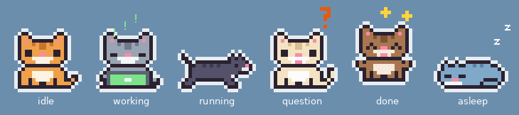
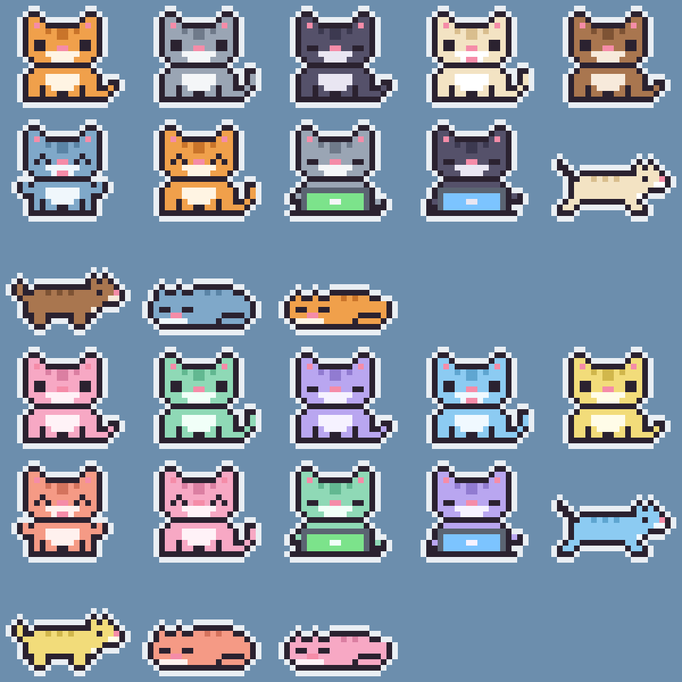

# we-always-need-cats

A small pixel art cat on your desktop, above every window, showing what each
Claude Code session is doing.



*Français : [README.fr.md](README.fr.md)*

- One cat per open Claude Code session, each with its own coat.
- One kitten per running subagent, in a color of its own.
- A speech bubble shows the project and the current action.

## What the cat does

| In Claude Code | What the cat does |
|---|---|
| Session open, nothing running | Sits in its spot, then falls asleep after 3 minutes |
| Claude is working | Types on its laptop; the bubble describes the action |
| Subagents running | Kittens work next to it |
| A question or a permission prompt | Runs to the mouse and follows it, orange bubble |
| Task finished | Runs to the mouse, jumps for joy, green bubble; goes home after 30 seconds |
| Session closed | The cat disappears |

The laptop screen is colored after the activity: green while writing a file,
blue while reading or searching, yellow for a command, purple for the web, pink
while delegating to an agent, light grey while thinking.

## Mouse

- Left click on the cat: it stops following the mouse and goes back home.
- Drag the cat: drop it somewhere else, which becomes its new home.
- Hover: shows the project name of a resting cat.
- Right click: send the cat home, dismiss that cat, or quit the program.

Clicks pass through everything that is transparent around the cat.

## Requirements

- Linux with a graphical session (Wayland or X11)
- Python 3.9 or later
- PyQt6, including the D-Bus module

```bash
# Arch / Manjaro
sudo pacman -S python-pyqt6
# Debian / Ubuntu
sudo apt install python3-pyqt6 python3-pyqt6.qtdbus
# or, in a virtual environment
pip install PyQt6
```

Under Wayland the program displays through XWayland, the only way to place a
window freely and keep it above the others. Following the mouse needs KWin
(KDE Plasma); everywhere else the cat stays in its spot and still reports what
Claude Code is doing.

## Install

```bash
git clone https://github.com/MmeOokamy/we-always-need-cats.git
cd we-always-need-cats
python3 install.py
```

The script registers the hooks in `~/.claude/settings.json`, keeping whatever
is already there, and copies the file to
`~/.claude/settings.json.backup-we-always-need-cats` first. The cats show up on
the next Claude Code event.

To install them for a single project instead:

```bash
python3 install.py --settings /path/to/project/.claude/settings.json
```

## Settings

Create a `config.json` file next to `cats.py` holding only the values you want
to change, then quit the program (right click on a cat): it starts again on the
next event.

```json
{
  "scale": 4,
  "follow_mouse": true,
  "follow_after_done": 30,
  "sleep_delay": 180,
  "speed": 800,
  "log": false
}
```

- `scale`: size of the cat (3 for smaller, 5 or 6 for bigger).
- `follow_mouse`: set to `false` to keep the cat in its spot at all times.
- `follow_after_done`: seconds spent following the mouse after a finished task.
- `sleep_delay`: seconds of idling before the cat falls asleep.
- `speed`: running speed, in pixels per second.
- `log`: write the received events to
  `~/.cache/we-always-need-cats/cats.log`.

## How it works

- `hook.py` is called by Claude Code on every event (hooks declared in
  `~/.claude/settings.json`). It sends the essentials of the event to the
  program over a local socket, and starts the program if it is not running.
- `cats.py` is the program showing the cats (Python and PyQt6). It quits by
  itself fifteen seconds after the last cat is gone.
- `kwin_cursor.js` is a KWin script loaded by `cats.py`. Under Wayland an
  application cannot read the mouse position: KWin reports it.
- `sprites.py` holds the drawings and the colors.
- `install.py` registers and removes the hooks.

## Editing the drawings

The drawings are grids of characters in `sprites.py`, one character per pixel.
After a change:

```bash
python3 sprites.py preview.png
```

writes a sheet of every sprite to check the result.



## Try it without Claude Code

```bash
python3 demo.py            # full scenario, about 40 seconds
python3 demo.py question   # a single state: idle, work, agents, question, done, end
```

## Uninstall

```bash
python3 install.py --uninstall
```

If you move this folder, run `python3 install.py` again from the new location:
the hooks hold the full path of `hook.py`.

## License

MIT, see [LICENSE](LICENSE).
